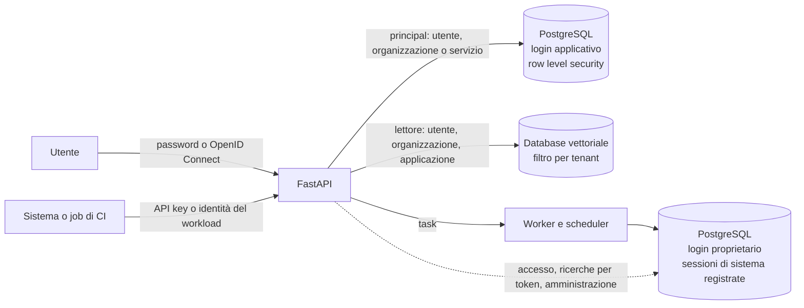

<!-- i18n source: README.md source_hash: ac3ec895b525 -->
<p align="center">
  
</p>

<h1 align="center">Keelson</h1>

<p align="center"><strong>Un servizio FastAPI per le aziende, pronto dal primo giorno.</strong><br>
Tenant separati dal database, single sign-on, un contratto API e un livello agentico,
ognuno presidiato da test.</p>

<p align="center">
  
  
  
  
  
</p>

[English](README.md) | Italiano

Avviare un servizio per le aziende significa risolvere gli stessi problemi prima della prima
funzionalità: tenere separati i dati di ogni cliente, far accedere gli utenti con il loro
provider di identità, dare agli altri sistemi un accesso controllato, pubblicare API che non
rompono i client e superare una revisione di sicurezza. Keelson genera un progetto FastAPI in
cui tutto questo è già fatto, verificato da test che girano nella sua pipeline, e lascia al
vostro team la parte che è solo vostra.

## Cosa è già fatto

- **I dati di ogni azienda restano suoi, e lo impone il database.** Row level security su ogni
  tabella, per un login applicativo che non può aggirarla; anche il database vettoriale filtra
  per tenant.
- **Persone e sistemi accedono come le aziende si aspettano.** Single sign-on con qualsiasi
  provider OpenID Connect, API key per organizzazione, e job di CI che si autenticano senza
  segreti salvati.
- **Un contratto API che non rompe i client.** Il documento OpenAPI è versionato, e la pipeline
  blocca disallineamenti e modifiche incompatibili.
- **Pronto per una revisione di sicurezza.** Segreti tenuti fuori dai log e cifrati a riposo,
  una traccia di audit, scansioni di dipendenze, immagini e storia, e una mappa dei controlli
  ISO 27001 e SOC 2.
- **Osservabile e pronto al deploy.** Log, trace e metriche dal primo avvio; Docker Compose con
  Traefik, Kubernetes, e una prova generale della produzione sulla propria macchina.
- **Pensato per essere mantenuto con gli agenti di programmazione.** Istruzioni, ruoli e le
  skill ufficiali dei componenti, vincolate e scansionate.

## Avvio rapido

```bash
uvx copier copy --trust https://github.com/salvo8519/keelson my_service
cd my_service
make quickstart      # configurazione, stack di sviluppo, migrazioni, un admin di sviluppo
make help            # ogni comando, per area
make prod-local      # lo stack di produzione su questa macchina: impostazioni di produzione, segreti locali
```

Keelson usa [Copier](https://copier.readthedocs.io): pone alcune domande, genera il progetto e
registra le risposte. Quando Keelson migliora, `uvx copier update --trust` porta le modifiche
nel vostro progetto e le unisce alle vostre, così un progetto non resta fermo alla versione da
cui è stato generato. Le domande e i loro valori predefiniti sono nel
[riferimento](docs/it/reference/questions.md).

| Domanda | Opzioni |
| --- | --- |
| Frontend | React (Vite, TanStack, shadcn/ui), nessuno |
| Coda dei task | Taskiq, Celery, ARQ |
| Framework agentico | Pydantic AI, LangGraph, LangChain, Deep Agents, Pydantic Deep |
| Provider LLM | OpenAI, Anthropic, Google, OpenRouter, compatibile OpenAI (on-premise), tutti |
| Database vettoriale | Qdrant, pgvector, nessuno |
| CI | GitHub Actions, GitLab CI |
| Kubernetes | sì, no |

## Come viene isolata una richiesta



Ogni transazione del login applicativo dichiara il proprio principal; senza, nessuna riga è
visibile. Il lavoro che non ha ancora un utente o attraversa più tenant (accesso, job in
background, riga di comando) usa il login proprietario tramite sessioni di sistema, ognuna
registrata con la sua motivazione.

## In sintesi

| Area | Cosa ha un progetto generato | Verificato da |
| --- | --- | --- |
| Tenancy | Row level security su ogni tabella, per comando; login applicativo separato che non possiede nulla; conversazioni dei membri private anche per i loro amministratori; ruoli verificati nel database | test di copertura delle tabelle e di attacco su un PostgreSQL reale |
| Identità | Single sign-on OpenID Connect (Entra ID, Google, Keycloak o qualsiasi issuer) con PKCE e nessun token negli URL; password Argon2id; API key con scope, scadenza, rotazione e audit; identità dei workload di CI per GitHub Actions e GitLab CI | test di accesso, password, API key e identità dei workload |
| Dati e retrieval | Ingestione dei documenti nei worker in background (PDF, Word, testo), embedding e reranking facoltativo, sorgenti sincronizzate, un tenant su ogni vettore, migrazioni Alembic | test di tenancy del retrieval e di ambito della ricerca, migrazioni in avanti e indietro |
| API | Contratto OpenAPI versionato, controllo delle modifiche incompatibili rispetto al branch di destinazione, client del frontend generato, riferimento Scalar white label, errori RFC 9457 nella lingua dell'utente | controlli di disallineamento del contratto e del client nella pipeline |
| Sicurezza | Oscuramento di messaggi, campi ed eccezioni nei log; chiavi ruotabili per i segreti a riposo; traccia di audit in sola aggiunta; la produzione rifiuta i segreti di sviluppo; gitleaks, scansioni di dipendenze e immagini, lint di sicurezza, SBOM | test-trappola sui log e test delle impostazioni di produzione, controlli della pipeline |
| Operatività | Log JSON con request id e trace id, OpenTelemetry, Prometheus, sonde di salute; `make prod-local`; Compose con Traefik e Let's Encrypt; manifest Kubernetes | ogni stack Compose risolto nei test |
| Lingue | Inglese e italiano in errori delle API, e-mail, interfaccia e documentazione | controlli dei cataloghi nella pipeline |

| Livello | Stack |
| --- | --- |
| Backend | Python 3.13, FastAPI, Pydantic 2, SQLAlchemy 2 (async), Alembic, PostgreSQL 16 |
| Lavoro in background | Taskiq, Celery o ARQ, con uno scheduler; Redis (Valkey) |
| Agenti e retrieval | Pydantic AI, LangGraph, LangChain, Deep Agents o Pydantic Deep; Qdrant o pgvector |
| Frontend | React, TypeScript, Vite, TanStack Router e Query, Tailwind CSS, shadcn/ui |
| Rilascio | Docker Compose, Traefik con Let's Encrypt, manifest Kubernetes, GitHub Actions o GitLab CI |
| Documentazione | Zensical, inglese e italiano, riferimento di API e impostazioni generato dal codice |

## Controlli di sicurezza

Un progetto generato implementa controlli richiesti da ISO/IEC 27001:2022 e SOC 2, ognuno
supportato da un file o da un test. Supporta un audit; non sostituisce i controlli
dell'organizzazione. La [mappa completa](docs/it/concepts/security-controls.md) elenca ogni
controllo, la sua evidenza e ciò che resta all'organizzazione. I percorsi indicati sono quelli
di un progetto generato (in questo repository, sotto `template/backend/`).

| Controllo | ISO 27001 | SOC 2 | Evidenza |
| --- | --- | --- | --- |
| Segregazione dei tenant | A.8.3 | CC6.1, C1.1 | `tests/test_segregation_postgres.py` |
| Privilegio minimo | A.5.15, A.8.2 | CC6.3 | `tests/test_rbac_teams.py` |
| Autenticazione sicura | A.8.5, A.5.17 | CC6.1, CC6.2 | `tests/test_sso.py`, `tests/test_security.py` |
| Crittografia | A.8.24 | CC6.1, CC6.7 | `tests/test_data_encryption.py` |
| Prevenzione della fuga di dati | A.8.12 | CC6.7 | `tests/test_log_trap.py` |
| Log e traccia di audit | A.8.15 | CC7.2 | `app/core/audit.py`, `tests/test_observability.py` |
| Configurazione sicura | A.8.9 | CC7.1 | `tests/test_production_settings.py` |
| Gestione delle modifiche | A.8.32 | CC8.1 | controlli del contratto API e delle migrazioni |
| Gestione delle vulnerabilità | A.8.8 | CC7.1 | scansioni di dipendenze e immagini |
| Catena di fornitura | A.5.21 | CC6.8, CC9.2 | SBOM, skill degli agenti vincolate e scansionate |

## Come è verificato

Ogni modifica al template genera progetti ed esegue i loro controlli: la suite del backend su
un PostgreSQL reale (segregazione del database e migrazioni incluse, dove un test saltato conta
come un fallimento), la build e le traduzioni del frontend, la build della documentazione, il
contratto API e il client generato, e ogni stack Compose. La revisione del codice su cui
Keelson si basa ha trovato difetti, tutti corretti con un test di regressione. Tra questi:
commit falliti che arrivavano al client come successi, token di accesso negli URL di
reindirizzamento, un filtro dei log che poteva stampare password, account collegati tramite
indirizzi e-mail non verificati, una ricerca che restituiva documenti di un'altra
organizzazione, e worker di produzione che giravano sull'immagine di sviluppo.
[PROVENANCE.md](PROVENANCE.md) elenca ogni modifica.

## Stato e limiti

Keelson è in pre-release. Cosa non è ancora verificato, o non ancora costruito:

- Le immagini Docker e gli stack Compose non sono ancora stati avviati nella pipeline di
  Keelson; la loro configurazione è risolta e controllata dai test.
- Il single sign-on è testato con un provider simulato, non ancora con un tenant reale di
  Entra ID o Keycloak.
- I test end-to-end nel browser (Playwright) del frontend non girano nella pipeline.
- Il frontend copre accesso, organizzazioni, membri, API key e amministrazione. La chat
  dell'agente e le knowledge base sono servite dalle API (REST e WebSocket) ma non hanno ancora
  un'interfaccia; è pianificato il porting dei componenti di chat del frontend Next.js di
  partenza.
- La row level security si fida del principal che l'applicazione dichiara sulla propria
  connessione: un'SQL injection nel login applicativo potrebbe cambiarlo. Il codice usa solo
  parametri vincolati; un contesto firmato dall'applicazione e verificato nel database è un
  possibile passo successivo.
- Pianificati: storage a oggetti compatibile S3 per i documenti (Garage come predefinito),
  mutation testing dei moduli di sicurezza, chart Helm.

## Documentazione

Il sito della documentazione è costruito con Zensical in inglese e italiano: primi passi,
concetti (tenancy, accesso e identità dei workload, controlli di sicurezza, lingue,
osservabilità), il riferimento di API e impostazioni generato dal codice, e come Keelson è
assemblato.

## Sviluppo del template

```bash
uv sync --all-groups
uv run just check            # stile, YAML, strumenti, traduzioni, test di rendering
uv run just test-generated   # genera i default ed esegue i controlli del progetto generato
uv run just skills           # installa le skill ufficiali dei componenti per gli agenti
```

Vedi [AGENTS.md](AGENTS.md) e [CONTRIBUTING.md](CONTRIBUTING.md).

## Basato su

Keelson poggia su due template open source e ne mantiene visibile il lavoro. Backend, worker e
livello agentico vengono dal
[Full-Stack AI Agent Template](https://github.com/vstorm-co/full-stack-ai-agent-template) di
Vstorm; il frontend React dal
[Full Stack FastAPI Template](https://github.com/fastapi/full-stack-fastapi-template)
ufficiale. Entrambi hanno licenza MIT. Keelson li importa a commit registrati, converte il
primo a Copier senza riscriverlo, e aggiunge i livelli di segregazione, identità, contratto,
sicurezza e lingue descritti sopra. [Come è assemblato Keelson](docs/it/concepts/assembly.md)
spiega il metodo.

## Licenza

Apache License 2.0 (vedi [LICENSE](LICENSE) e [NOTICE](NOTICE)). Gli avvisi dei due template
con licenza MIT sono in [THIRD_PARTY_NOTICES.md](THIRD_PARTY_NOTICES.md) e vengono riportati in
ogni progetto generato. La licenza non concede alcun diritto di usare il nome o il logo di
Keelson.
