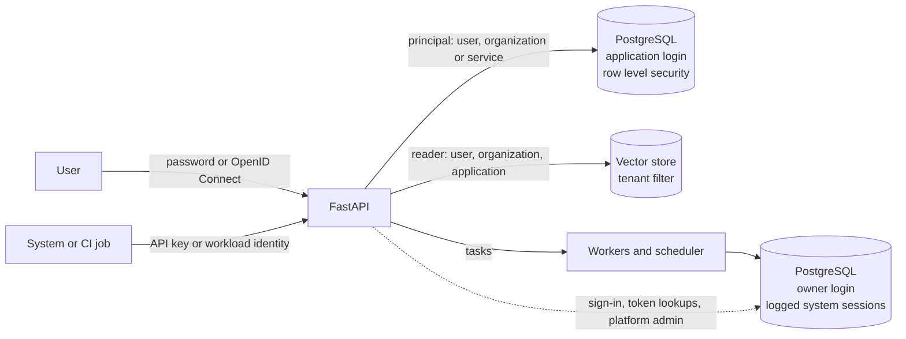

<p align="center">
  
</p>

<h1 align="center">Keelson</h1>

<p align="center"><strong>A FastAPI service for companies, ready on day one.</strong><br>
Tenants segregated by the database, single sign-on, an API contract and an agent layer,
each guarded by tests.</p>

<p align="center">
  
  
  
  
  
</p>

English | [Italiano](README.it.md)

Starting a service for companies means solving the same problems before the first feature:
keeping each customer's data apart, signing in through their identity provider, giving other
systems controlled access, publishing an API that does not break its clients, and passing a
security review. Keelson generates a FastAPI project where these are already done, verified by
tests that run in its pipeline, and leaves your team the part that is specific to you.

## What is already done

- **Each company's data stays its own, enforced by the database.** Row level security on every
  table, for an application login that cannot bypass it; the vector store filters by tenant too.
- **People and systems sign in the way companies expect.** Single sign-on with any OpenID
  Connect provider, API keys per organization, and CI jobs that authenticate without stored
  secrets.
- **An API contract that does not break its clients.** The OpenAPI document is versioned, and
  the pipeline stops drift and breaking changes.
- **Ready for a security review.** Secrets kept out of logs and encrypted at rest, an audit
  trail, scans of dependencies, images and history, and a map of ISO 27001 and SOC 2 controls.
- **Observable and deployable.** Logs, traces and metrics from the first start; Docker Compose
  with Traefik, Kubernetes, and a rehearsal of production on your own machine.
- **Built to be maintained with coding agents.** Instructions, roles and the official skills of
  the components, pinned and scanned.

## Quick start

```bash
uvx copier copy --trust https://github.com/salvo8519/keelson my_service
cd my_service
make quickstart      # configuration, development stack, migrations, a development admin
make help            # every command, by area
make prod-local      # the production stack on this machine: production settings, local secrets
```

Keelson uses [Copier](https://copier.readthedocs.io): it asks a few questions, renders the
project and records your answers. When Keelson improves, `uvx copier update --trust` brings the
changes into your project and merges them with your own, so a project does not stay at the
version it was generated from. The questions and their defaults are in the
[reference](docs/en/reference/questions.md).

| Question | Options |
| --- | --- |
| Frontend | React (Vite, TanStack, shadcn/ui), none |
| Task queue | Taskiq, Celery, ARQ |
| Agent framework | Pydantic AI, LangGraph, LangChain, Deep Agents, Pydantic Deep |
| LLM provider | OpenAI, Anthropic, Google, OpenRouter, OpenAI-compatible (on-premise), all |
| Vector database | Qdrant, pgvector, none |
| CI | GitHub Actions, GitLab CI |
| Kubernetes | yes, no |

## How a request is isolated



Every transaction of the application login states its principal; without one, no row is
visible. Work that has no user yet or spans tenants (sign-in, background jobs, the command
line) uses the owner login through system sessions, each logged with its reason.

## At a glance

| Area | What a generated project has | Verified by |
| --- | --- | --- |
| Tenancy | Row level security on every table, per command; separate application login that owns nothing; members' conversations private even to their administrators; roles checked in the database | table coverage and attack tests on a real PostgreSQL |
| Identity | OpenID Connect single sign-on (Entra ID, Google, Keycloak or any issuer) with PKCE and no tokens in URLs; Argon2id passwords; API keys with scopes, expiry, rotation and audit; CI workload identity for GitHub Actions and GitLab CI | sign-in, password, API key and workload identity tests |
| Data and retrieval | Document ingestion in background workers (PDF, Word, text), embeddings and optional reranking, sync sources, a tenant on every vector, Alembic migrations | retrieval tenancy and search scope tests, migrations up and down |
| API | Versioned OpenAPI contract, breaking-change check against the target branch, generated frontend client, white-label Scalar reference, RFC 9457 errors in the user's language | contract drift and client checks in the pipeline |
| Security | Redaction of messages, fields and exceptions in logs; rotatable keys for secrets at rest; append-only audit trail; production refuses development secrets; gitleaks, dependency and image scans, security lint, SBOM | log trap and production settings tests, pipeline gates |
| Operations | JSON logs with request and trace ids, OpenTelemetry, Prometheus, health probes; `make prod-local`; Compose with Traefik and Let's Encrypt; Kubernetes manifests | every Compose stack resolved in the tests |
| Languages | English and Italian in API errors, e-mails, the interface and the documentation | catalog checks in the pipeline |

| Layer | Stack |
| --- | --- |
| Backend | Python 3.13, FastAPI, Pydantic 2, SQLAlchemy 2 (async), Alembic, PostgreSQL 16 |
| Background work | Taskiq, Celery or ARQ, with a scheduler; Redis (Valkey) |
| Agents and retrieval | Pydantic AI, LangGraph, LangChain, Deep Agents or Pydantic Deep; Qdrant or pgvector |
| Frontend | React, TypeScript, Vite, TanStack Router and Query, Tailwind CSS, shadcn/ui |
| Delivery | Docker Compose, Traefik with Let's Encrypt, Kubernetes manifests, GitHub Actions or GitLab CI |
| Documentation | Zensical, English and Italian, API and settings reference generated from the code |

## Security controls

A generated project implements controls that ISO/IEC 27001:2022 and SOC 2 ask for, each backed
by a file or a test. It supports an audit; it does not replace the organization's own
controls. The [full map](docs/en/concepts/security-controls.md) lists every control, its
evidence and what remains with the organization. Paths below are those of a generated project
(in this repository, under `template/backend/`).

| Control | ISO 27001 | SOC 2 | Evidence |
| --- | --- | --- | --- |
| Tenant segregation | A.8.3 | CC6.1, C1.1 | `tests/test_segregation_postgres.py` |
| Least privilege | A.5.15, A.8.2 | CC6.3 | `tests/test_rbac_teams.py` |
| Secure authentication | A.8.5, A.5.17 | CC6.1, CC6.2 | `tests/test_sso.py`, `tests/test_security.py` |
| Cryptography | A.8.24 | CC6.1, CC6.7 | `tests/test_data_encryption.py` |
| Data leakage prevention | A.8.12 | CC6.7 | `tests/test_log_trap.py` |
| Logging and audit trail | A.8.15 | CC7.2 | `app/core/audit.py`, `tests/test_observability.py` |
| Secure configuration | A.8.9 | CC7.1 | `tests/test_production_settings.py` |
| Change management | A.8.32 | CC8.1 | API contract and migration checks |
| Vulnerability management | A.8.8 | CC7.1 | dependency and image scans |
| Supply chain | A.5.21 | CC6.8, CC9.2 | SBOM, pinned and scanned agent skills |

## How it is verified

Every change to the template renders projects and runs their checks: the backend suite
against a real PostgreSQL (database segregation and migrations included, where a skipped test
counts as a failure), the frontend build and translations, the documentation build, the API
contract and the generated client, and every Compose stack. The review of the code Keelson
builds on found defects that are fixed, each with a regression test. Among them: commits that
reached the client as successes after failing, access tokens placed in redirect URLs, a log
filter that could print passwords, accounts linked through unverified e-mail addresses, a
search that returned another organization's documents, and production workers running the
development image. [PROVENANCE.md](PROVENANCE.md) lists every change.

## Status and limits

Keelson is a pre-release. What is not yet verified, or not yet built:

- The Docker images and Compose stacks have not been started in Keelson's own pipeline yet;
  their configuration is resolved and checked by the tests.
- Single sign-on is tested against a simulated provider, not yet against a live Entra ID or
  Keycloak tenant.
- The end-to-end browser tests (Playwright) of the frontend are not run in the pipeline.
- The frontend covers sign-in, organizations, members, API keys and administration. The agent
  chat and the knowledge bases are served by the API (REST and WebSocket) but have no
  interface yet; porting the chat components of the upstream Next.js frontend is planned.
- Row level security trusts the principal the application states on its connection: SQL
  injected into the application login could change it. The code uses bound parameters only;
  a context signed by the application and verified in the database is a possible next step.
- Planned: S3-compatible object storage for documents (Garage by default), mutation testing of
  the security modules, Helm charts.

## Documentation

The documentation site is built with Zensical in English and Italian: getting started,
concepts (tenancy, sign-in and workload identity, security controls, languages,
observability), the API and settings reference generated from the code, and how Keelson is
assembled.

## Development of the template

```bash
uv sync --all-groups
uv run just check            # house style, YAML, tooling, translations, render tests
uv run just test-generated   # render the defaults and run the generated project's checks
uv run just skills           # install the official component skills for agents
```

See [AGENTS.md](AGENTS.md) and [CONTRIBUTING.md](CONTRIBUTING.md).

## Built on

Keelson stands on two open source templates and keeps their work visible. The backend, the
workers and the agent layer come from the
[Full-Stack AI Agent Template](https://github.com/vstorm-co/full-stack-ai-agent-template) by
Vstorm; the React frontend from the official
[Full Stack FastAPI Template](https://github.com/fastapi/full-stack-fastapi-template). Both are
MIT-licensed. Keelson imports them at recorded commits, converts the first to Copier without
rewriting it, and adds the segregation, identity, contract, security and language layers
described above. [How Keelson is assembled](docs/en/concepts/assembly.md) explains the method.

## Licence

Apache License 2.0 (see [LICENSE](LICENSE) and [NOTICE](NOTICE)). The notices of the two
MIT-licensed templates are in [THIRD_PARTY_NOTICES.md](THIRD_PARTY_NOTICES.md) and are carried
into every generated project. The licence grants no right to use the Keelson name or logo.
