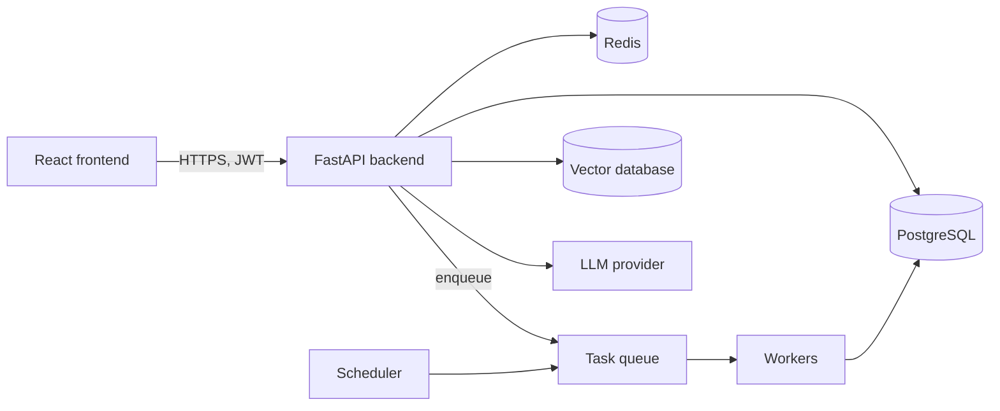

# Architecture of a generated project

A generated project is one repository with a backend, an optional frontend, and the files to
run and deploy them.

## Backend

The backend follows a layered layout: versioned routes under `app/api/routes/v1/` call
services in `app/services/`, which use repositories in `app/repositories/` over SQLAlchemy 2
with asyncio and Alembic migrations. Settings come from environment variables through
Pydantic Settings.

| Area | What the project contains |
| --- | --- |
| Identity | Users, JWT access and refresh tokens, password hashing, magic links, invitations by email |
| Organizations | Each user has a personal organization and can join others with a role (owner, admin, member, viewer). The active organization of a request comes from the `X-Organization-Id` header, checked against the membership. |
| Agent layer | The chosen agent framework, conversation history, streaming over WebSocket, tools |
| Retrieval | Ingestion, chunking, embeddings and search on the chosen vector database |
| Operations | Rate limiting on Redis, caching, Prometheus metrics, health and readiness endpoints, structured logs |

## Workers and scheduling

The task queue runs in separate processes: workers execute tasks, a scheduler enqueues the
periodic ones. With Taskiq, both processes start from `app/worker/taskiq_worker.py`, which
loads every task module; the API process imports only the tasks it enqueues. On Kubernetes
the scheduler runs as a single replica, so each schedule fires once.

## Frontend

React with TypeScript, Vite, TanStack Router and Query, Tailwind CSS and shadcn/ui. The API
client is generated from the backend's OpenAPI document (`bun run generate-client`).

## Delivery

Docker Compose files for development, staging and production; Traefik with automatic HTTPS
in production; Kubernetes manifests (API, workers, scheduler, configuration, ingress); a GitHub
or GitLab pipeline that lints, tests and builds the images.
