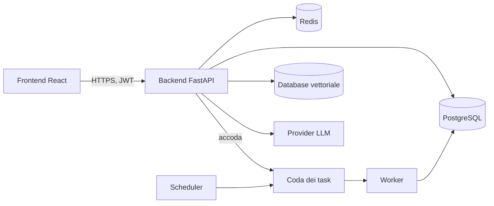

# Architettura di un progetto generato

Un progetto generato è un unico repository con un backend, un frontend opzionale e i file per
eseguirli e distribuirli.

## Backend

Il backend segue un'organizzazione a livelli: le route versionate in `app/api/routes/v1/`
chiamano i servizi in `app/services/`, che usano i repository in `app/repositories/` su
SQLAlchemy 2 con asyncio e migrazioni Alembic. La configurazione arriva dalle variabili
d'ambiente tramite Pydantic Settings.

| Area | Cosa contiene il progetto |
| --- | --- |
| Identità | Utenti, token JWT di accesso e di refresh, hashing delle password, magic link, inviti via email |
| Organizzazioni | Ogni utente ha un'organizzazione personale e può entrare in altre con un ruolo (owner, admin, member, viewer). L'organizzazione attiva di una richiesta arriva dall'header `X-Organization-Id`, verificato contro l'appartenenza. |
| Livello agentico | Il framework agentico scelto, lo storico delle conversazioni, lo streaming via WebSocket, i tool |
| Retrieval | Ingestion, chunking, embedding e ricerca sul database vettoriale scelto |
| Esercizio | Rate limiting su Redis, cache, metriche Prometheus, endpoint di health e readiness, log strutturati |

## Worker e scheduling

La coda dei task gira in processi separati: i worker eseguono i task, uno scheduler accoda
quelli periodici. Con Taskiq entrambi i processi partono da `app/worker/taskiq_worker.py`,
che carica tutti i moduli dei task; il processo dell'API importa solo i task che accoda. Su
Kubernetes lo scheduler gira con una sola replica, così ogni schedulazione scatta una volta.

## Frontend

React con TypeScript, Vite, TanStack Router e Query, Tailwind CSS e shadcn/ui. Il client delle
API è generato dal documento OpenAPI del backend (`bun run generate-client`).

## Distribuzione

File Docker Compose per sviluppo, staging e produzione; Traefik con HTTPS automatico in
produzione; manifest Kubernetes (API, worker, scheduler, configurazione, ingress); una
pipeline GitLab o GitHub che esegue lint, test e build delle immagini.
